<a href="https://guilhermecmt.github.io/#gh-dark-mode-only"></a><a href="https://guilhermecmt.github.io/#gh-light-mode-only"></a>

  
  
  

I'm a full-stack developer from Brazil. Most of my time goes into the software Grupo Texas
runs on, and the rest into products of my own. I like owning the whole path, from the first
database table to the server it runs on, and that's usually how I work.

 

## ◆ At work

The platforms I built for **Grupo Texas** replace paid subscriptions with software the company
owns and hosts itself. The repositories are private, but I'm always happy to talk about how
they're built.

<a href="https://guilhermecmt.github.io/#gh-dark-mode-only">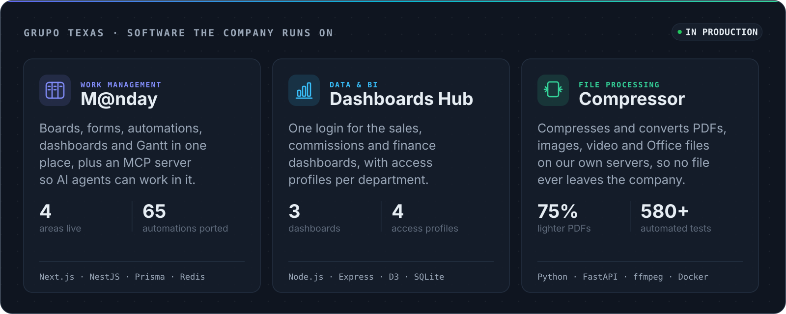</a><a href="https://guilhermecmt.github.io/#gh-light-mode-only">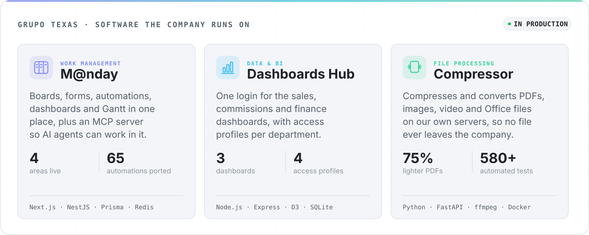</a>

 

## ◆ On my own time

Each card opens the full write-up, with screenshots, on my
[portfolio](https://guilhermecmt.github.io/).

  <a href="https://guilhermecmt.github.io/projetos/academia-dos-sabios/#gh-dark-mode-only"></a> <a href="https://guilhermecmt.github.io/projetos/alexandria/#gh-dark-mode-only"></a><!--
  --><a href="https://guilhermecmt.github.io/projetos/academia-dos-sabios/#gh-light-mode-only"></a> <a href="https://guilhermecmt.github.io/projetos/alexandria/#gh-light-mode-only"></a>

  <a href="https://guilhermecmt.github.io/projetos/gymnous-mind/#gh-dark-mode-only"></a> <a href="https://guilhermecmt.github.io/projetos/stockgenius/#gh-dark-mode-only"></a><!--
  --><a href="https://guilhermecmt.github.io/projetos/gymnous-mind/#gh-light-mode-only"></a> <a href="https://guilhermecmt.github.io/projetos/stockgenius/#gh-light-mode-only"></a>

  <a href="https://guilhermecmt.github.io/projetos/rookgaard/#gh-dark-mode-only"></a> <a href="https://guilhermecmt.github.io/projetos/arteaqui/#gh-dark-mode-only"></a><!--
  --><a href="https://guilhermecmt.github.io/projetos/rookgaard/#gh-light-mode-only"></a> <a href="https://guilhermecmt.github.io/projetos/arteaqui/#gh-light-mode-only"></a>

Most of these repositories are private. If you'd like to review the code of any of them, ask and I'll give you access.
Academia dos Sábios is <a href="https://academia-dos-sabios-server.vercel.app">live here</a>.

 

## ◆ Open source

  <a href="https://github.com/Guilhermecmt/Nous-Webui#gh-dark-mode-only"></a> <a href="https://github.com/Guilhermecmt/HUB-LLM-LOCAL#gh-dark-mode-only"></a><!--
  --><a href="https://github.com/Guilhermecmt/Nous-Webui#gh-light-mode-only"></a> <a href="https://github.com/Guilhermecmt/HUB-LLM-LOCAL#gh-light-mode-only"></a>

 

## ◆ Toolbox

Day to day I write mostly TypeScript and Python.

  

also: DuckDB · Capacitor · Ollama · Playwright · BullMQ · ffmpeg

 

## ◆ Get in touch

If you'd like to talk about a project or just say hi, I'd love to hear from you.

**Email** &nbsp;[guilherme@texasseguros.com](mailto:guilherme@texasseguros.com) &nbsp;&nbsp;·&nbsp;&nbsp; **Phone** &nbsp;+55&nbsp;71&nbsp;99128-3493

And if you visit the [portfolio](https://guilhermecmt.github.io/), look around carefully:
there may be an easter egg hidden somewhere in there. Or maybe a lot of them.
